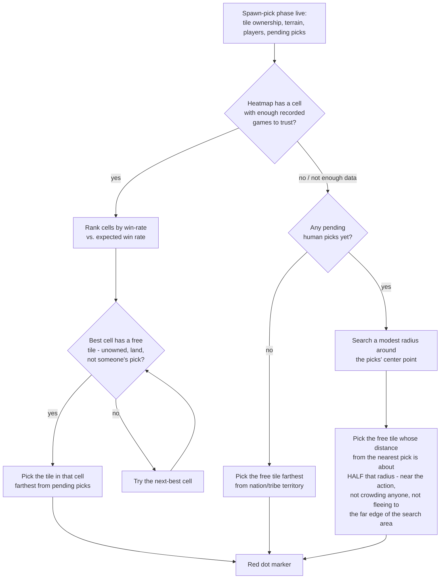

# OpenFront Spawn Heatmap Overlay

A Chrome extension that overlays [ofstats.io](https://ofstats.io) spawn heatmaps directly onto [openfront.io](https://openfront.io), so you can see the best (and worst) spots to spawn without leaving the game — and, during the spawn-pick countdown, marks the single best tile for you.

## Heatmap panel

- Blue = worse than expected win rate, red = better, white = as expected.
- Updates automatically as you pick a map (hosting) or join someone's lobby.
- Draggable, resizable, collapsible.

## Best-spawn marker

During the spawn-pick phase, a **red dot** appears on the map at the tile the extension thinks is your best spawn right now. It updates live as other players move their picks.

- When the current map has enough recorded history on ofstats.io, the suggestion comes straight from that heatmap — it looks for the strongest-performing area with enough games behind it to trust, then the best open tile inside it.
- On a map with little or no history yet, it falls back to a live calculation: a tile a moderate distance from other players' pending picks (close enough to be in the action, far enough not to crowd anyone) and away from nation/tribe territory.
- It only ever suggests unowned, land tiles — never water, never someone else's claim.

### How it decides

The "half the radius, not the far edge" step exists on purpose — an earlier version maximized that distance instead, which just found the single most isolated spot available (an island, a dead-end corner) every time. See `STEP4.md` for the full story.

## Setup (Chrome / Edge)

This isn't on the Chrome Web Store, so it's loaded as an "unpacked" extension — takes about a minute. Edge uses the same Chromium extensions system, just swap `chrome://extensions` for `edge://extensions` below.

1. **Download the extension folder.**
   - If you got this as a zip, unzip it anywhere.
   - If you're cloning the repo: `git clone` it, you just need the `extension/` folder.
2. Open `chrome://extensions` in Chrome, or `edge://extensions` in Edge (paste that into the address bar).
3. Turn on **Developer mode** (toggle, top-right corner).
4. Click **Load unpacked**.
5. Select the `extension` folder (the one with `manifest.json` in it).
6. Done — go to [openfront.io](https://openfront.io) and host or join a lobby. The heatmap panel appears top-right automatically once a map is selected.

## Setup (Firefox)

Same extension, no code changes needed — just a different load path. This loads it temporarily (gone on browser restart).

1. Download the extension folder (same as above).
2. Open `about:debugging#/runtime/this-firefox` in Firefox.
3. Click **Load Temporary Add-on**.
4. Select the `manifest.json` file inside the `extension` folder.
5. Done — go to [openfront.io](https://openfront.io) and host or join a lobby.

To reload after an update, click the ⟳ reload button next to the extension on that same page.

For a permanent (survives restart) Firefox install, the extension needs to be signed by Mozilla — zip the `extension` folder and submit it at [addons.mozilla.org](https://addons.mozilla.org/developers/) for a signed `.xpi`.

## Updating

If you get a newer version of the extension, replace the `extension` folder with the new files, then go back to `chrome://extensions` and click the reload icon (⟳) on the extension's card. The version number on the card (e.g. `0.2.1`) tells you which build you're on.

## Usage

- **Drag** the panel by its header to move it anywhere on screen.
- **Resize** by dragging the bottom-right corner.
- **Collapse** with the `–`/`+` button in the header.
- The heatmap updates whenever the selected/joined map changes.
- The red best-spawn marker appears automatically once the spawn-pick countdown starts. (It doesn't yet hide itself once the game begins — a known, deliberately-deferred rough edge, not a bug.)
